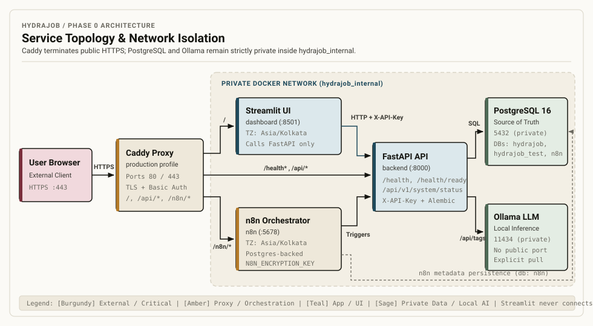
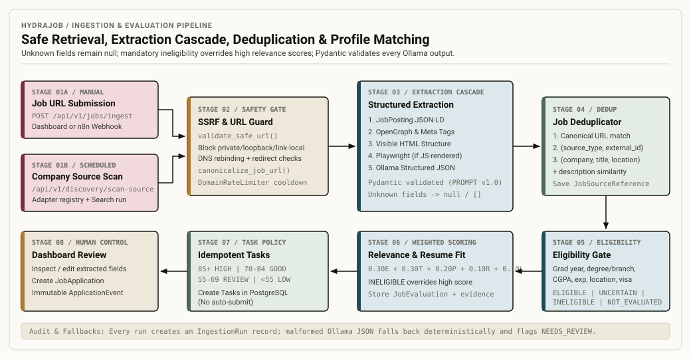

# HydraJob Architecture

## Overview

HydraJob is a self-hosted, personal AI-powered job discovery and application management platform deployed with Docker Compose, designed to run locally during development and on AWS EC2 with EBS persistence in production.

## Core Principles

1. **PostgreSQL is the single source of truth.** All application data lives in PostgreSQL (`hydrajob`), with a separate `hydrajob_test` database for automated testing and a dedicated `n8n` database for workflow persistence. See [docs/database_schema.md](database_schema.md) for all 13 tables and rules.
2. **n8n coordinates; Python implements business logic.** n8n schedules and triggers workflows against FastAPI HTTP endpoints (`http://backend:8000`) rather than reimplementing domain logic.
3. **Streamlit communicates exclusively with FastAPI.** The Streamlit dashboard connects to `API_BASE_URL=http://backend:8000` over the internal Docker network and never connects directly to PostgreSQL.
4. **Local/private AI via Ollama.** All LLM inference uses a self-hosted Ollama instance (`http://ollama:11434`) kept strictly on the private Docker network (`hydrajob_internal`), with no OpenAI/ChatGPT API dependency. Every Ollama output is validated with Pydantic.
5. **Security & SSRF by default.**
   - PostgreSQL (`5432`) and Ollama (`11434`) are never exposed to the public internet.
   - In local dev (`docker-compose.yml`), ports bind only to `127.0.0.1`.
   - In production (`docker-compose.prod.yml` + `--profile production`), direct host ports for `postgres`, `backend`, `dashboard`, and `n8n` are removed so only Caddy (`80`, `443`) faces the internet with HTTPS and Basic Auth.
   - Backend `/api/v1/*` routes enforce `X-API-Key` validation via `APP_API_KEY`.
   - Submitted job URLs pass SSRF validation (blocking localhost, private/link-local IPs, DNS rebinding, and unsafe redirects).
6. **Timezones.** Backend persistence and internal timestamps use UTC; user-facing displays (Streamlit and n8n) use `Asia/Kolkata`.
7. **Human-in-the-loop control.** HydraJob never automatically submits job applications and never bypasses authentication walls or CAPTCHAs.

---

## Service Topology



```text
Internet / User Browser
    |
    +--- HTTPS (80/443) ---> Caddy Reverse Proxy (production profile, Basic Auth + TLS)
                                |
                                +---> dashboard (Streamlit :8501)
                                |        |
                                |        +---> HTTP (X-API-Key) ---> backend (FastAPI :8000)
                                |
                                +---> backend (/health*, /api/*)
                                |
                                +---> n8n (/n8n/* or dedicated subdomain :5678)
                                         |
                                         +---> HTTP (X-API-Key) ---> backend (:8000)

Private Docker Network (hydrajob_internal):
    backend (:8000) ---> postgres (:5432) [databases: hydrajob, hydrajob_test]
    backend (:8000) ---> ollama   (:11434) [private only, no host port]
    n8n     (:5678) ---> postgres (:5432) [database: n8n]
```

---

## Ingestion, Extraction & Evaluation Pipeline



1. **Safe Retrieval:** URLs pass `validate_safe_url()` and `canonicalize_job_url()`, with `DomainRateLimiter` enforcing per-domain cooldowns.
2. **Extraction Cascade:** `JobPosting` JSON-LD -> OpenGraph/meta -> visible HTML structure -> optional Playwright rendering -> optional Ollama structured extraction (`PROMPT_VERSION = "v1.0"`). Unknown fields remain `null` or `[]`.
3. **Deduplication:** Matches canonical URL, `(source_type, external_id)`, or `(normalized_company, normalized_title, normalized_location)` with description similarity, preserving all `JobSourceReference` entries.
4. **Eligibility & Scoring:** Mandatory eligibility criteria (`graduation_year`, `degree_branch`, `min_cgpa`, `experience_years`, `location`, `work_authorization`) are evaluated before relevance scoring (`0.30*E + 0.30*T + 0.20*P + 0.10*R + 0.10*L`). Mandatory `INELIGIBLE` overrides high relevance scores.
5. **Task Policy & Audit:** Idempotent internal tasks are generated according to configurable score thresholds (`85+`, `70–84`, `55–69`, `<55`) and tracked alongside immutable `ApplicationEvent` records.

---

## Data Model & UI Style

- **Schema & Deduplication Details:** [docs/database_schema.md](database_schema.md) (with [figures/data_model_er.svg](../figures/data_model_er.svg))
- **UI & Diagram Conventions:** [docs/ui_style_guide.md](ui_style_guide.md)
