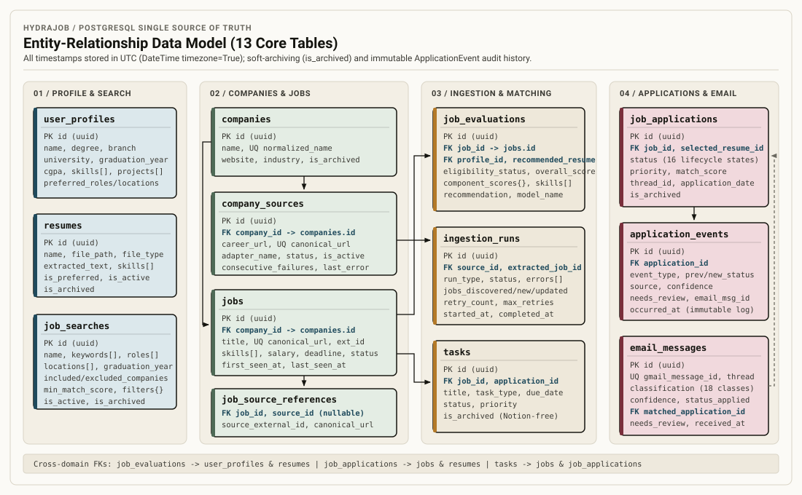

# HydraJob Database Schema (Phase 1–8)

PostgreSQL (`postgres:16-alpine`) is the single source of truth for HydraJob. Three databases are initialized in the PostgreSQL cluster (via `supporting_codes/postgres-init/01-init-databases.sh`):

- `hydrajob`: primary application database
- `hydrajob_test`: isolated test database
- `n8n`: dedicated n8n orchestration persistence database

All schema changes are managed exclusively through Alembic (`backend/alembic/versions/`). All timestamps use timezone-aware `DateTime(timezone=True)` stored in **UTC** (`TimestampMixin`: `created_at`, `updated_at`), while user-facing interfaces convert to `Asia/Kolkata`.

---

## 1. Core Tables (13 Tables)

### `user_profiles` (`UserProfile`)
Configurable candidate profile used by the eligibility gate and Ollama matching engine.
- **Columns:** `id` (UUID PK), `name`, `email`, `education`, `degree`, `branch`, `university`, `graduation_year`, `cgpa`, `experience_summary`, `projects` (JSON list), `skills` (JSON list), `preferred_roles` (JSON list), `preferred_locations` (JSON list), `excluded_locations` (JSON list), `work_authorization`, `created_at`, `updated_at`.
- **Seeding:** Auto-seeded on first `GET /api/v1/profile` if empty, and editable via API/Dashboard.

### `resumes` (`Resume`)
Multiple resume versions for skill-overlap recommendation and application tracking.
- **Columns:** `id` (UUID PK), `name`, `file_path`, `file_type`, `extracted_text`, `skills` (JSON list), `is_preferred`, `is_active`, `is_archived`, `created_at`, `updated_at`.
- **Security:** Resume files and extracted text are never exposed publicly.

### `companies` (`Company`)
Tracked employer organizations.
- **Columns:** `id` (UUID PK), `name`, `normalized_name` (unique, indexed), `website`, `industry`, `description`, `notes`, `is_archived`, `created_at`, `updated_at`.

### `company_sources` (`CompanySource`)
Registered company career pages and public job-board feeds.
- **Columns:** `id` (UUID PK), `company_id` (FK -> `companies.id` CASCADE), `source_name`, `career_url`, `canonical_url` (unique, indexed), `source_type`, `extraction_method`, `adapter_name`, `status`, `config_json` (JSON), `is_active`, `is_archived`, `consecutive_failures`, `last_checked_at`, `last_successful_scan_at`, `last_error`, `created_at`, `updated_at`.
- **Source Statuses:** `READY`, `NEEDS_CONFIGURATION`, `DISABLED`.

### `jobs` (`Job`)
Canonical job opening records.
- **Columns:** `id` (UUID PK), `company_id` (FK -> `companies.id` CASCADE), `title`, `normalized_title` (indexed), `description`, `location`, `normalized_location` (indexed), `country`, `employment_type`, `workplace_type`, `experience_requirement`, `graduation_year_requirement`, `degree_requirement`, `required_skills` (JSON), `preferred_skills` (JSON), `responsibilities` (JSON), `qualifications` (JSON), `salary`, `currency`, `application_deadline`, `application_url`, `canonical_url` (unique, indexed), `external_job_id` (indexed), `source_metadata` (JSON), `raw_extraction_data` (JSON), `status`, `is_active`, `is_archived`, `missing_scan_count`, `first_seen_at`, `last_seen_at`, `last_changed_at`, `created_at`, `updated_at`.
- **Job Statuses:** `ACTIVE`, `NEEDS_REVIEW`, `CLOSED`, `ARCHIVED`.
- **Incremental Scanning Rule:** A job is not marked `CLOSED` from a single failed scan (`missing_scan_count` tracks consecutive absences).

### `job_source_references` (`JobSourceReference`)
Preserves every URL and external source ID where a deduplicated job was observed.
- **Columns:** `id` (UUID PK), `job_id` (FK -> `jobs.id` CASCADE), `source_id` (FK -> `company_sources.id` SET NULL), `source_external_id`, `original_url`, `canonical_url` (indexed), `first_seen_at`, `last_seen_at`, `created_at`, `updated_at`.

### `job_evaluations` (`JobEvaluation`)
Profile matching, eligibility evaluation, and scoring evidence snapshots.
- **Columns:** `id` (UUID PK), `job_id` (FK -> `jobs.id` CASCADE), `profile_id` (FK -> `user_profiles.id` SET NULL), `recommended_resume_id` (FK -> `resumes.id` SET NULL), `eligibility_status`, `overall_score` (0–100), `component_scores` (JSON: `eligibility`, `technical`, `experience`, `role_relevance`, `location`), `matched_skills` (JSON), `missing_skills` (JSON), `strengths` (JSON), `concerns` (JSON), `recommendation`, `explanation`, `model_name`, `evaluation_version`, `evaluated_at`, `created_at`, `updated_at`.
- **Eligibility Statuses:** `ELIGIBLE`, `UNCERTAIN`, `INELIGIBLE`, `NOT_EVALUATED`.
- **Recommendation Tiers:** `HIGH_PRIORITY` (`85+`), `GOOD` (`70–84`), `REVIEW` (`55–69`), `LOW_RELEVANCE` (`<55` or mandatory `INELIGIBLE` override).

### `job_applications` (`JobApplication`)
Tracked application lifecycle linked to a job and optional resume version.
- **Columns:** `id` (UUID PK), `job_id` (FK -> `jobs.id` CASCADE), `selected_resume_id` (FK -> `resumes.id` SET NULL), `status` (indexed), `priority`, `match_score`, `eligibility_status`, `application_date`, `notes`, `thread_id` (indexed), `is_archived`, `created_at`, `updated_at`.

### `application_events` (`ApplicationEvent`)
Immutable audit log of every manual and email-originated status transition.
- **Columns:** `id` (UUID PK), `application_id` (FK -> `job_applications.id` CASCADE), `event_type`, `previous_status`, `new_status`, `source` (e.g., `manual`, `email`), `description`, `confidence`, `needs_review`, `email_message_id`, `occurred_at`.
- **Immutability Rule:** Historical events are appended and never overwritten or deleted silently.

### `tasks` (`Task`)
Internal actionable tasks in PostgreSQL (works completely without Notion).
- **Columns:** `id` (UUID PK), `title`, `description`, `job_id` (FK -> `jobs.id` SET NULL), `application_id` (FK -> `job_applications.id` SET NULL), `task_type`, `due_date`, `status` (indexed), `priority`, `external_task_id`, `is_archived`, `created_at`, `updated_at`.
- **Task Statuses:** `PENDING`, `IN_PROGRESS`, `COMPLETED`, `CANCELLED`.

### `job_searches` (`JobSearch`)
Saved discovery filters and minimum score thresholds.
- **Columns:** `id` (UUID PK), `name`, `keywords` (JSON), `roles` (JSON), `categories` (JSON), `locations` (JSON), `remote_preference`, `employment_types` (JSON), `graduation_year`, `experience_level`, `included_companies` (JSON), `excluded_companies` (JSON), `min_match_score`, `filters` (JSON), `is_active`, `is_archived`, `created_at`, `updated_at`.

### `ingestion_runs` (`IngestionRun`)
Execution audit log for single-URL intake, company source scans, and search runs.
- **Columns:** `id` (UUID PK), `url`, `canonical_url` (indexed), `source_id` (FK -> `company_sources.id` SET NULL), `run_type` (`URL_INGEST | SOURCE_SCAN | SEARCH_RUN`), `status` (indexed: `QUEUED | RUNNING | COMPLETED | NEEDS_REVIEW | FAILED`), `extracted_job_id` (FK -> `jobs.id` SET NULL), `jobs_discovered`, `jobs_new`, `jobs_updated`, `errors` (JSON), `retry_count`, `max_retries`, `started_at`, `completed_at`, `created_at`, `updated_at`.

### `email_messages` (`EmailMessage`)
Recruitment email metadata, classification, confidence, and review queue tracking.
- **Columns:** `id` (UUID PK), `gmail_message_id` (unique, indexed), `thread_id` (indexed), `sender`, `sender_domain` (indexed), `subject`, `snippet`, `received_at` (indexed), `classification`, `confidence`, `matched_application_id` (FK -> `job_applications.id` SET NULL), `status_applied`, `needs_review`, `review_notes`, `created_at`, `updated_at`.

---

## 2. Application Lifecycle & Email Classification States

### All 16 `JobApplication.status` Values

`DISCOVERED` · `TO_APPLY` · `PREPARING` · `APPLIED` · `ACKNOWLEDGED` · `UNDER_REVIEW` · `OA_RECEIVED` · `OA_COMPLETED` · `TECHNICAL_TEST` · `INTERVIEW_SCHEDULED` · `INTERVIEW_COMPLETED` · `FURTHER_ROUNDS` · `OFFER_RECEIVED` · `REJECTED` · `WITHDRAWN` · `CLOSED`

### All 18 `EmailMessage.classification` Values

`APPLICATION_ACKNOWLEDGEMENT` · `APPLICATION_RECEIVED` · `UNDER_REVIEW` · `OA_INVITATION` · `ASSESSMENT_REMINDER` · `ASSESSMENT_COMPLETED` · `TECHNICAL_TEST` · `INTERVIEW_INVITATION` · `INTERVIEW_RESCHEDULE` · `INTERVIEW_FEEDBACK` · `NEXT_ROUND` · `REJECTION` · `OFFER` · `DOCUMENT_REQUEST` · `INFORMATION_REQUEST` · `WITHDRAWAL` · `NON_RECRUITMENT` · `UNKNOWN`

### Email Confidence & Regression Policy

- `confidence >= 0.90` **and** unambiguous single application match: automatic status update + append `ApplicationEvent`, preventing backward/regressive transitions (e.g., an `ACKNOWLEDGEMENT` never regresses `INTERVIEW_SCHEDULED`).
- `0.70 <= confidence < 0.90` **or** multiple active applications at the same company: queued with `needs_review = true` for human review.
- `confidence < 0.70`: no automatic application status change.

---

## 3. Job Deduplication Rules

1. **Canonical URL match:** Normalize scheme/host lowercase, strip URL fragments and tracking query parameters (`utm_*`, `gh_src`, `gh_jid`, `ashby_jid`, `ref`, `source`, `fbclid`, `gclid`), and strip trailing slashes. Exact `canonical_url` match merges into the existing `Job`.
2. **Source external ID match:** Match `(source_type, external_id)` via `jobs.external_job_id` / `job_source_references.source_external_id`.
3. **Composite identity + description similarity:** Match `(normalized_company, normalized_title, normalized_location)` **only** when description similarity exceeds threshold, ensuring unrelated openings with identical titles at different locations or teams are never wrongly merged.
4. **Provenance preservation:** Every matched or newly created discovery updates/appends a `JobSourceReference` row so all originating URLs remain traceable.
